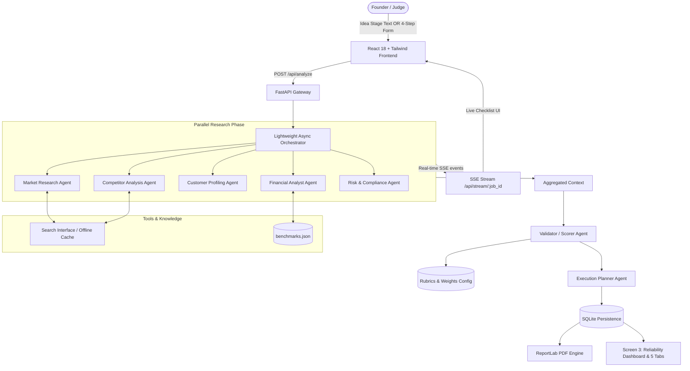

# 🚀 Startup Co-Pilot (PS08)
> **Autonomous Multi-Agent Startup Research, Reliability Scoring & Execution Planning Platform**

Startup Co-Pilot is an end-to-end multi-agent AI system designed for early-stage founders. Built upon the core UX principle of **"One input → one progress view → one result"**, it provides market research, competitor benchmarking, customer persona modeling, financial auditing against industry benchmarks, legal risk assessment, a deterministic 10-pillar reliability score, and a concrete 30-60-90 day execution roadmap.

---

## ⚡ Quickstart (Under 3 Commands)

```bash
# 1. Install dependencies
npm install

# 2. Run local development server
npm run dev
```
Open **`http://localhost:5173`** in your browser!

## 🚀 Deploying to Render (Pure React Static Site — No Docker)

1. Push this repository to GitHub.
2. In [Render Dashboard](https://dashboard.render.com), click **New +** → **Static Site**.
3. Select your repository.
4. Settings:
   - **Build Command**: `npm install && npm run build`
   - **Publish Directory**: `dist`
5. Click **Create Static Site** — Render deploys it live in ~30 seconds!

---

## 🏗️ Architecture Overview



---

## 🌟 Key Features & Capabilities

- **Dual Mode Support**:
  - **Idea Stage Mode**: Single large textarea with industry/target market dropdowns and 3 instant one-click demo chips. Excludes traction/unit economics to prevent manufactured certainty.
  - **Running Startup Mode**: 4-step progressive wizard (Basics → Traction → Business → Team/Legal). Every field features a *"Don't know / Skip"* toggle that falls back to industry-standard benchmarks.
- **7 Autonomous Specialized Agents**:
  1. *Market Research Agent*: Computes TAM/SAM/SOM with 1-line plain language explanations, CAGR, and timing drivers.
  2. *Competitor Analysis Agent*: Maps 3-5 competitors, strengths/weaknesses, positioning whitespace, and defensibility moats.
  3. *Customer Profiling Agent*: Profiles 2-3 detailed buyer personas, daily pain points, makeshift alternatives, and willingness to pay.
  4. *Financial Analyst Agent*: Audits unit economics (CAC, LTV, margins, payback) against `benchmarks.json`.
  5. *Risk & Compliance Agent*: Analyzes legal, regulatory, licensing, and DPDP Act 2023 compliance.
  6. *Validator / Scorer Agent*: Evaluates the 10 success pillars, computes overall score (0–10) with 🟢/🟡/🔴 badges, and generates a stage-aware verdict.
  7. *Execution Planner Agent*: Generates a 30-60-90 day milestone roadmap with role owners and quantitative KPIs.
- **Live Real-time SSE Progress Screen**: Live agent checklist with states (⬜ waiting, ⏳ running, ✅ done, ❌ failed with retry) and streaming telemetry.
- **Pitch Deck PDF Parsing**: Upload existing pitch decks to auto-populate the form.
- **PDF Export & Clipboard Sharing**: Server-side ReportLab PDF generation with complete audit details.

---

## 📊 The 10 Success Pillars

| # | Pillar | Description | Idea Stage | Running Startup |
|---|---|---|:---:|:---:|
| 1 | **Problem–Solution Fit** | Severity of pain point and clarity of solution | 25% | 10% |
| 2 | **Market Size & Timing** | TAM/SAM/SOM, market headwinds, CAGR | 20% | 10% |
| 3 | **Competition & Moat** | Defensive moat and positioning gap | 15% | 10% |
| 4 | **Customer Demand** | Persona specificity, willingness to pay | 20% | 10% |
| 5 | **Business Model** | Monetization clarity and pricing alignment | 10% | 10% |
| 6 | **Unit Economics** | CAC, LTV, gross margin %, payback period | *N/A (0%)* | 12.5% |
| 7 | **Team & Execution** | Domain experience and technical capacity | 10% | 10% |
| 8 | **Traction & Growth** | Paying customers, MoM growth %, churn rate | *N/A (0%)* | 12.5% |
| 9 | **Financial Health** | Runway, burn rate, funding sufficiency | *N/A (0%)* | 10% |
| 10 | **Legal & Compliance** | Data privacy (DPDP), licensing, IP risks | *Advisory* | 5% |

---

## 🛠️ Tech Stack & Decisions

- **Frontend**: React 18, Vite, TypeScript, Tailwind CSS, Lucide Icons.
- **Backend**: Python 3.11, FastAPI, Pydantic v2, ReportLab, pypdf, SQLite.
- **Orchestration**: Custom lightweight async orchestrator using `asyncio.gather` with streaming queue dispatch.
- **LLM Engine**: Provider-agnostic client supporting Google Gemini (default), OpenAI, and an offline High-Fidelity Mock Engine for zero-setup demo reliability.
- **Currency Support**: Automatic formatting in Indian Rupees (₹, Lakh, Crore) and US Dollars ($).

---

## 🧪 Testing & Verification

Run the full automated test suite (scoring logic, benchmark matching, contradiction detection, API endpoints, PDF generation, and E2E pipeline):

```bash
python -m pytest backend/tests/
```

All 12 unit and integration tests pass cleanly in under 2 seconds!

---

## 📄 License & Disclaimer

AI-based analysis. Not investment or legal advice. Built for hackathon demonstration.
