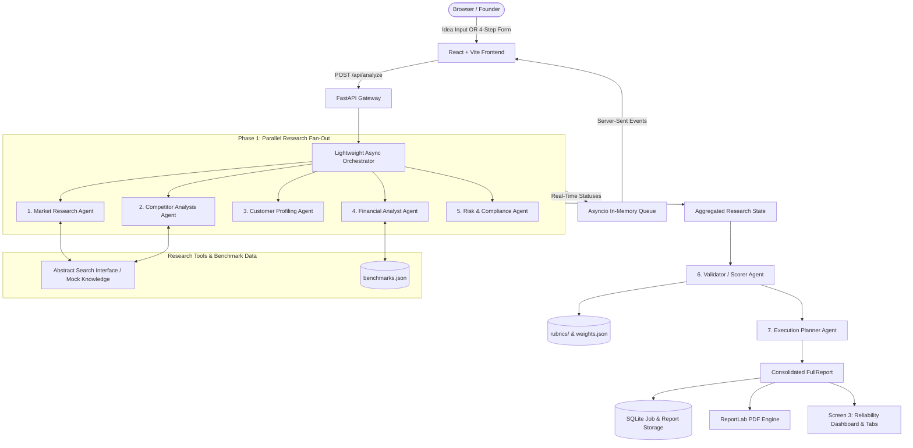

# Startup Co-Pilot: System Architecture & Design Specification

**Problem Statement:** PS08 (Multi-Agent System for Early-Stage Startup Research, Validation, and Execution Planning).

## 1. High-Level Architecture

Startup Co-Pilot is engineered around the core UX tenet: **"One input → one progress view → one result."**

---

## 2. Multi-Agent System & Dependencies

| Agent | Responsibilities | Output Schema |
|---|---|---|
| **Orchestrator** | Input parsing, mode detection, contradiction checking, parallel execution management via `asyncio.gather`, SSE event broadcasting. | `AgentStatus`, `StreamEvent` |
| **Market Research Agent** | TAM/SAM/SOM sizing with plain-English definitions, CAGR growth rate, timing analysis ("Why now?"), 3-5 trends, verified sources. | `MarketReport` |
| **Competitor Analysis Agent** | 3-5 competitors (direct + indirect), strengths, weaknesses, pricing model, positioning whitespace, defensible moat. | `CompetitorReport` |
| **Customer Profiling Agent** | 2-3 target personas (name, role, acute pain, current alternative, willingness to pay), demand evidence, acquisition channels. | `CustomerReport` |
| **Financial Analyst Agent** | Monetization review, unit economics (LTV:CAC, gross margins, payback), cash runway audit, benchmark comparison vs `benchmarks.json`. | `FinancialReport` |
| **Risk & Compliance Agent** | Legal, regulatory, licensing, IP, and data privacy analysis (DPDP Act 2023, RBI, sector norms). | `RiskReport` |
| **Validator / Scorer Agent** | Consolidates all agent outputs, evaluates 10 pillars against rubrics, calculates overall weighted reliability score, confidence level, top 3 actions, and stage-aware verdict. | `ReliabilityReport` |
| **Execution Planner Agent** | Synthesizes a concrete 30-60-90 day milestone roadmap with tasks, role owners, priorities, and quantitative KPIs. | `ExecutionPlan` |

---

## 3. The 10 Success Pillars & Weight Normalization

To avoid manufactured certainty, **Idea Stage** startups exclude financial and traction pillars (6, 8, 9) because pre-revenue concepts lack empirical metrics. Weights are mathematically re-normalized to 100%:

$$\text{Normalized Weight}_i = \frac{W_i}{\sum_{j \in \text{Active}} W_j}$$

- **Score Statuses**:
  - 🟢 **Strong**: Score $\ge 7.0$
  - 🟡 **Needs Work**: Score $4.0 - 6.9$
  - 🔴 **Risk**: Score $< 4.0$
  - ⚪ **Not Applicable**: Excluded for Idea Stage

---

## 4. Reliability Safeguards

1. **Evidence-Based Scoring:** Every score has an explicit evidence basis (`User traction data`, `Market research source`, or `Benchmark median assumption`).
2. **Transparent Assumption Log:** If a metric is skipped in the 4-step wizard, the system infers industry medians from `benchmarks.json` and visibly surfaces it in the dashboard and exported PDF.
3. **Contradiction Detection:** Evaluates business logic integrity (e.g., revenue $> 0$ with 0 paying customers, or runway $< 6$ months with 0 burn) and issues active warnings.
4. **Resilient Offline Mock Mode:** If external LLM or Search API keys are missing, the app defaults gracefully to an offline knowledge base and deterministic generator so evaluation never breaks.
5. **Prompt Injection Shielding:** User input is strictly serialized as passive evaluation data in structured JSON blocks, preventing prompt injection instructions.
